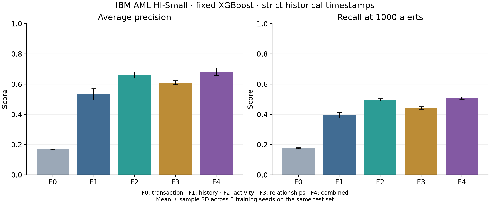

# Phát hiện giao dịch rửa tiền bằng học máy

Đồ án môn **An toàn và bảo mật hệ thống thông tin**, chương trình thạc sĩ.
Nghiên cứu ảnh hưởng của đặc trưng lịch sử, hoạt động theo thời gian và quan hệ tài khoản
đến XGBoost trên **IBM AML HI-Small**.

## Báo cáo và số liệu

- [Báo cáo PDF — 14 trang](reports/bao_cao_atbmhttt.pdf).
- [Bản Word chỉnh sửa](reports/bao_cao_atbmhttt.docx) và [bản Markdown](reports/bao_cao_atbmhttt.md).
- [Phương pháp và định nghĩa đặc trưng](docs/feature-study-method.md).
- [Bằng chứng số liệu](reports/evidence/feature_study/) và [biểu đồ PDF](reports/assets/feature_ablation.pdf).

## Kết quả chính

Thực nghiệm ngày **29/10/2026**: năm cấu hình × ba seed 0/1/2, cùng XGBoost và cách chia dữ liệu;
không augmentation hoặc tìm siêu tham số. AP là Average Precision, lưu dưới tên `pr_auc` trong CSV.

| Cấu hình | Số đặc trưng | AP, mean ± sample SD | Precision@1000 | Recall@1000 |
|---|---:|---:|---:|---:|
| F0 — giao dịch | 11 | 0.1708 ± 0.0021 | 0.3183 | 0.1770 |
| F1 — thêm lịch sử | 28 | 0.5339 ± 0.0369 | 0.7117 | 0.3958 |
| F2 — lịch sử + hoạt động | 48 | 0.6617 ± 0.0204 | 0.8933 | 0.4968 |
| F3 — lịch sử + quan hệ | 43 | 0.6104 ± 0.0137 | 0.7983 | 0.4440 |
| F4 — kết hợp | 63 | **0.6841 ± 0.0247** | **0.9150** | **0.5089** |



Trong 1.000 cảnh báo cao nhất trên toàn test, F4 tìm được trung bình 915 nhãn dương so với khoảng 712 của F1.
Nhóm hoạt động đem lại lợi ích lớn hơn nhóm quan hệ khi bổ sung riêng; kết hợp cải thiện tiếp trong cả ba seed.

**Giới hạn:** dữ liệu mô phỏng; test đã dùng trong nghiên cứu trước; ba seed chỉ đo biến động huấn luyện.
Lưu lượng và tỷ lệ nhãn thay đổi mạnh từ 11/09. Chẩn đoán hậu kiểm trên cùng phần test trước mốc này
vẫn ghi nhận AP F1→F4 tăng 0.3330→0.5283. Không loại bỏ phần cuối để thay kết quả chính,
không suy ra ý nghĩa thống kê hoặc hiệu quả tại ngân hàng thực tế.

## Dữ liệu và quy tắc thời gian

Tải [IBM Transactions for AML](https://www.kaggle.com/datasets/ealtman2019/ibm-transactions-for-anti-money-laundering-aml),
đặt `HI-Small_Trans.csv` tại `data/raw/`. Dữ liệu thô và dự đoán từng giao dịch không được đưa vào Git.

- Tổng: 5.078.345 giao dịch, 5.177 nhãn dương.
- Train: 3.046.861 / 2.297 dương; validation: 1.015.602 / 1.082; test: 1.015.882 / 1.798.
- Chia thời gian xấp xỉ 60/20/20; không chia một timestamp sang hai tập.
- Lịch sử chỉ dùng `t_j < t`; các dòng cùng phút dùng chung lịch sử. Cửa sổ `[t−1h,t)` và `[t−24h,t)`.
- Các tổng tiền mới tính riêng tiền tệ, dùng số tiền nhận cho bên nhận; không giả định thêm tỷ giá/KYC.
- ID tài khoản chỉ là khóa tra cứu. Nhãn không tham gia tính đặc trưng; ngưỡng chọn trên validation.

Phiên bản chính: `strict-time-feature-study-v1`. Hash, cột, thư viện và tham số nằm trong
[manifest](reports/evidence/feature_study/manifest.json). [Kết quả xác minh](reports/evidence/feature_study/verification.json)
ghi nhận 15 lượt và 30 file dự đoán đã được kiểm tra độc lập.

## Chạy lại

Sử dụng Python 3.11–3.13 và môi trường ảo:

```powershell
python -m venv .venv
.\.venv\Scripts\python.exe -m pip install -r requirements.txt
.\.venv\Scripts\python.exe -B -m unittest discover -s tests
# CPU cục bộ; có thể đặt AML_DEVICE=cuda nếu môi trường hỗ trợ GPU.
.\.venv\Scripts\python.exe -B run_feature_study.py --output-dir results/feature_study_local
```

Chạy GPU trên notebook Kaggle **riêng tư**:

```powershell
.\.venv\Scripts\python.exe -B kaggle/build_feature_kernel.py --owner YOUR_KAGGLE_USERNAME
.\.venv\Scripts\python.exe -B kaggle/run_cli.py kernels push -p kaggle/kernel_features --accelerator NvidiaTeslaT4 --timeout 10800
.\.venv\Scripts\python.exe -B kaggle/run_cli.py kernels output YOUR_KAGGLE_USERNAME/aml-feature-study-20261029 -p results/feature_study_kaggle --file-pattern '^results/' --quiet
.\.venv\Scripts\python.exe -B analyze_feature_study.py --result-dir results/feature_study_kaggle/results/feature_study_20261029 --output-dir results/feature_study_analysis --submission kaggle/kernel_features/kernel.py
```

Notebook đã chạy: [snnasnguyen/aml-feature-study-20261029](https://www.kaggle.com/code/snnasnguyen/aml-feature-study-20261029).
Notebook là riêng tư; người khác cần tự chạy hoặc được cấp quyền phù hợp. Bundle chỉ chứa file trong allowlist.

Xuất lại Word/PDF từ Markdown và số liệu tổng hợp đã commit:

```powershell
.\.venv\Scripts\python.exe -m pip install -r requirements-report.txt
.\.venv\Scripts\python.exe -B scripts/export_report.py
```

Muốn tính lại AP từ dự đoán cần output Kaggle hoặc chạy lại. Bản clone chỉ kèm số liệu tổng hợp,
không chứa dữ liệu thô, cache và 30 file dự đoán lớn.

## Mã nguồn

| File | Vai trò |
|---|---|
| `src/feature_study.py` | 63 đặc trưng; snapshot cùng phút; cửa sổ/tiền tệ/quan hệ |
| `src/data.py` | Đọc dữ liệu và chia tập không giao timestamp |
| `src/model.py` | XGBoost, ngưỡng validation và chỉ số |
| `run_feature_study.py` | Năm cấu hình × ba seed, manifest và dự đoán |
| `analyze_feature_study.py` | Xác minh, phân rã nhóm, chẩn đoán và biểu đồ |
| `kaggle/build_feature_kernel.py` | Bundle riêng tư, dependency pinning và GPU |
| `scripts/export_report.py` | Báo cáo Word/PDF tiếng Việt |
| `tests/` | 43 kiểm tra hồi quy của pipeline |

## Thí nghiệm augmentation mở rộng

Pipeline trước thử E0, lặp mẫu, SMOTENC, CTGAN và hai prompt LLM, tỷ lệ bổ sung 0,5.
Số liệu được giữ ở [reports/evidence/augmentation/](reports/evidence/augmentation/).
LLM chưa cải thiện AP trong cấu hình đó. Baseline cũ `causal-seconds-v3` cho phép thứ tự dòng trong cùng phút,
khác protocol chính; không so trực tiếp AP hai đợt.

Mã tái lập: `run_experiments.py`, `generate_llm_rerun.py`, `analyze_results.py`, `kaggle/build_kernel.py`.
Nghiên cứu đặc trưng chính không gọi API LLM. Khi chạy augmentation LLM, giữ ledger ngân sách và
kiểm tra cache identity; không xóa ledger để chạy lại cùng đợt.

## Cấu hình riêng tư

`.env`, `llm_config.py`, `.kaggle/`, token, dữ liệu và cache được Git bỏ qua. Tự cấu hình xác thực Kaggle
cục bộ; `kaggle/run_cli.py` đọc `.env` mà không in token. Khi cần API LLM cho nghiên cứu mở rộng,
sao chép `llm_config.example.py` thành `llm_config.py` rồi cấu hình riêng trên máy.
Repository chỉ chứa file mẫu không có khóa; không đưa khóa API/token vào mã, báo cáo hoặc notebook.
