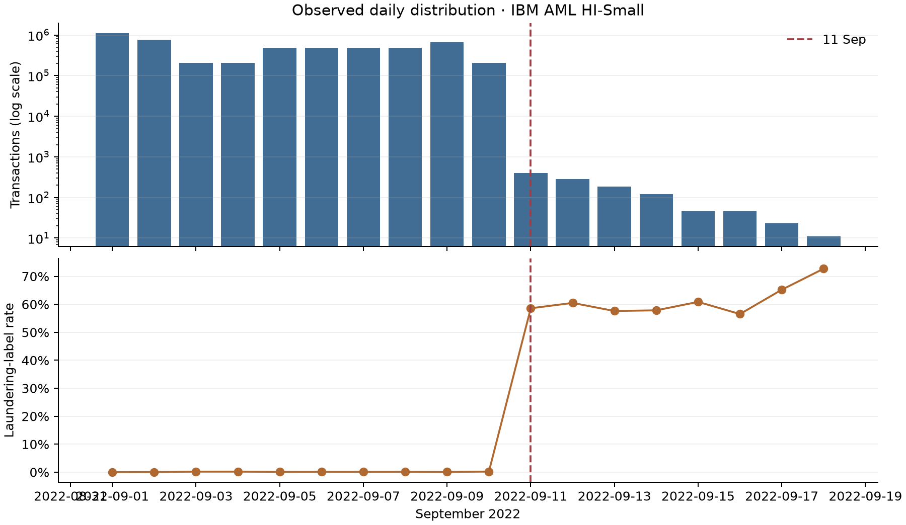

# PHÁT HIỆN GIAO DỊCH RỬA TIỀN BẰNG HỌC MÁY KẾT HỢP ĐẶC TRƯNG HÀNH VI THEO THỜI GIAN VÀ QUAN HỆ TÀI KHOẢN

**BÁO CÁO ĐỒ ÁN MÔN HỌC**

**Học phần:** An toàn và bảo mật hệ thống thông tin (ATBMHTTT)

**Bậc đào tạo:** Thạc sĩ

**Ngày hoàn thành thực nghiệm:** 29/10/2026

**Phạm vi:** Nghiên cứu thực nghiệm trên dữ liệu mô phỏng IBM AML HI-Small.

## Tóm tắt

Báo cáo nghiên cứu vai trò của cách biểu diễn dữ liệu trong phát hiện giao dịch rửa tiền bằng học máy. Thay vì thay đổi đồng thời thuật toán và dữ liệu huấn luyện, nghiên cứu giữ cố định bộ phân loại XGBoost, sử dụng dữ liệu gốc và lần lượt bổ sung ba nhóm thông tin: lịch sử tài khoản, hoạt động trong cửa sổ thời gian và quan hệ đối tác giao dịch. Năm cấu hình được đánh giá trên cùng cách chia dữ liệu theo thời gian, mỗi cấu hình chạy ba seed.

Thực nghiệm sử dụng 5.078.345 giao dịch của IBM AML HI-Small, trong đó 5.177 giao dịch được gán nhãn rửa tiền. Đặc trưng lịch sử chỉ được tính từ các giao dịch có timestamp nhỏ hơn thời điểm dự đoán; các giao dịch cùng phút không được quan sát lẫn nhau. Các tổng tiền mới được tính riêng theo tiền tệ. Average Precision (AP) trung bình tăng từ 0,1708 khi chỉ dùng thuộc tính từng giao dịch lên 0,5339 khi thêm lịch sử và 0,6841 khi kết hợp đầy đủ các nhóm đặc trưng. Với 1.000 cảnh báo có điểm cao nhất trên toàn tập test, cấu hình đầy đủ đạt precision 91,50% và recall 50,89%.

Phân tích bổ sung phát hiện phân bố dữ liệu thay đổi mạnh từ ngày 11/09/2022. Trong phần test trước mốc này, AP vẫn tăng từ 0,3330 lên 0,5283 giữa cấu hình lịch sử và cấu hình đầy đủ. Kết quả cho thấy giá trị của thông tin hành vi và quan hệ trong cấu hình đã khảo sát. Tuy nhiên, đây là đánh giá thăm dò trên dữ liệu mô phỏng và một tập test đã dùng trong nghiên cứu trước; chưa đủ cơ sở kết luận hiệu quả trên dữ liệu ngân hàng thực tế hoặc ý nghĩa thống kê trên quần thể giao dịch mới.

**Từ khóa:** phát hiện rửa tiền, XGBoost, khai phá dữ liệu, đặc trưng thời gian, quan hệ tài khoản, dữ liệu mất cân bằng.

## Mục lục

1. Giới thiệu và mục tiêu nghiên cứu
2. Cơ sở và nghiên cứu liên quan
3. Dữ liệu và định nghĩa bài toán
4. Tiền xử lý và xây dựng đặc trưng
5. Thiết kế và quy trình thực nghiệm
6. Kết quả và phân tích
7. Thảo luận, giới hạn và ý nghĩa đối với ATBMHTTT
8. Kết luận và hướng phát triển
9. Tài liệu tham khảo
10. Phụ lục tái lập và thí nghiệm mở rộng

## 1. Giới thiệu và mục tiêu nghiên cứu

### 1.1. Đặt vấn đề

Trong một hệ thống giám sát giao dịch, từng lần chuyển tiền thường chỉ cung cấp một phần thông tin về hành vi của tài khoản. Một khoản chuyển tiền có thể phù hợp với hoạt động thông thường, nhưng mức độ cần xem xét sẽ khác nếu tài khoản vừa nhận tiền từ nhiều đối tác mới hoặc thay đổi mạnh về tần suất giao dịch. Do đó, biểu diễn mỗi giao dịch như một dòng độc lập có thể bỏ qua bối cảnh hữu ích.

Ví dụ minh họa: giao dịch A chuyển tiền cho B không tự nó chứng minh rửa tiền. Tuy nhiên, lịch sử nhận/gửi gần đây, mức độ quen thuộc giữa A và B, cùng độ lệch của số tiền so với lịch sử tài khoản có thể hỗ trợ xếp hạng mức nghi ngờ. Các thông tin này cần được chuyển thành đặc trưng định lượng trước khi đưa vào mô hình.

Trong phạm vi môn ATBMHTTT, bài toán được tiếp cận như một cơ chế hỗ trợ phát hiện và ưu tiên cảnh báo. Đầu ra không thay thế kết luận điều tra; giá trị cần đánh giá là khả năng tìm được nhiều giao dịch gán nhãn rửa tiền hơn khi số cảnh báo cần kiểm tra được giới hạn.

### 1.2. Mục tiêu và câu hỏi nghiên cứu

Mục tiêu là đánh giá tác động của các nhóm đặc trưng trong điều kiện giữ nguyên mô hình, dữ liệu huấn luyện và quy tắc đánh giá. Ba câu hỏi được đặt ra:

- **RQ1:** Lịch sử tài khoản có cải thiện phát hiện so với chỉ sử dụng thông tin từng giao dịch không?
- **RQ2:** Hoạt động theo cửa sổ thời gian và quan hệ đối tác có bổ sung thông tin khi đã có lịch sử không?
- **RQ3:** Mức cải thiện thể hiện như thế nào tại ngân sách 1.000 cảnh báo, và có còn quan sát được khi tách phần dữ liệu có phân bố thời gian khác biệt không?

RQ1 và RQ2 thuộc thiết kế năm cấu hình trước khi chạy. Phân tích tách giai đoạn trong RQ3 được bổ sung sau khi quan sát phân bố theo ngày; báo cáo giữ nguyên phép đánh giá chính và ghi rõ tính hậu kiểm của chẩn đoán này.

### 1.3. Phạm vi và đóng góp của đồ án

Đồ án sử dụng một bộ dữ liệu mô phỏng, một bộ phân loại chính và các đặc trưng có thể giải thích bằng lịch sử giao dịch. Nghiên cứu không đề xuất thuật toán boosting mới, không khẳng định phát minh hướng khai thác đặc trưng đồ thị và không đánh giá triển khai tại ngân hàng thật.

Đóng góp thực nghiệm gồm: xây dựng bộ 63 đặc trưng có quy tắc thời gian rõ ràng; phân rã tác động qua năm cấu hình và ba seed; đánh giá theo AP và ngân sách cảnh báo; kiểm tra tính đúng của đặc trưng và số liệu từ dự đoán; phân tích sự thay đổi phân bố theo thời gian và giới hạn khái quát hóa.

## 2. Cơ sở và nghiên cứu liên quan

### 2.1. Dữ liệu AML dạng bảng và dạng đồ thị

Một mạng giao dịch có thể biểu diễn tài khoản bằng nút và giao dịch có thời gian bằng cạnh có hướng. Cách nhìn này giúp xây dựng thông tin về đối tác và hoạt động vào/ra. Đồ án chuyển các thống kê đó thành cột dữ liệu để XGBoost sử dụng; không huấn luyện mạng nơ-ron đồ thị (GNN).

### 2.2. Các nghiên cứu làm nền tảng

Altman và cộng sự công bố bộ dữ liệu AML tổng hợp và trình sinh dựa trên mô phỏng tác nhân để hỗ trợ đánh giá mô hình phát hiện rửa tiền. IBM AML HI-Small được sử dụng trong đồ án thuộc nguồn dữ liệu này. Dữ liệu có nhãn từ mô phỏng, không phải dữ liệu ngân hàng đã ẩn danh [1, 4].

Graph Feature Preprocessor của Blanuša và cộng sự khai thác mẫu đồ thị giao dịch để bổ sung đặc trưng cho mô hình boosting. Công trình này cung cấp cơ sở cho hướng biểu diễn quan hệ trước khi phân loại. Đồ án hiện tại chỉ khảo sát thống kê quan hệ cục bộ và cửa sổ thời gian, không tái hiện toàn bộ thuật toán GFP hoặc so sánh trực tiếp điểm số với công trình đó [2].

XGBoost là hệ thống học tăng cường cây quyết định được Chen và Guestrin giới thiệu. Trong đồ án, XGBoost là bộ phân loại giữ cố định để đo tác động của nhóm đặc trưng, thay vì là đối tượng cải tiến thuật toán [3].

### 2.3. Vị trí của nghiên cứu này

Phân biệt cần giữ rõ là thay đổi biểu diễn dữ liệu và thay đổi thuật toán. Khi đồng thời thay mô hình, đặc trưng và siêu tham số, mức tăng điểm khó quy về một thành phần. Nghiên cứu này giới hạn thay đổi chính ở các nhóm đặc trưng. Kết quả vì vậy trả lời câu hỏi thực nghiệm cụ thể: các nhóm thông tin có ích hay không đối với XGBoost và protocol đã chọn.

## 3. Dữ liệu và định nghĩa bài toán

### 3.1. Bộ dữ liệu

Nguồn đầu vào là `HI-Small_Trans.csv`, phân phối tại trang dữ liệu IBM Transactions for Anti-Money Laundering [4]. File cục bộ được đối chiếu hash SHA-256 với file sử dụng trên Kaggle:

```text
b19d39f515523373f991b689c07e11e7b0b95c17a2c27a87d91584ae16c5b040
```

File có 5.078.345 giao dịch, 5.177 nhãn dương, tương đương khoảng 0,102%. Khoảng timestamp quan sát được là 01–18/09/2022. Đây là thống kê của file đã sử dụng, không phải giả định mọi phiên bản AMLWorld đều có cùng quy mô.

Các trường chính gồm thời gian, ngân hàng/tài khoản gửi, ngân hàng/tài khoản nhận, số tiền gửi và nhận, tiền tệ hai phía, hình thức thanh toán và nhãn `Is Laundering`. Hai cột tài khoản có tên gốc trùng nhau được pandas đọc thành `Account` và `Account.1`.

### 3.2. Đầu vào và đầu ra mô hình

Đơn vị dự đoán là một giao dịch. Tại thời điểm t, đầu vào gồm thuộc tính hiện tại và các thống kê xây dựng từ lịch sử không nhãn có thời gian nhỏ hơn t. Nhãn đích là 0 cho giao dịch bình thường và 1 cho giao dịch được mô phỏng là rửa tiền.

Đầu ra là điểm nghi ngờ dùng để xếp hạng. Khi cần quyết định nhị phân, mô hình áp dụng ngưỡng chọn trên validation. Báo cáo không coi điểm dự đoán là xác suất rủi ro đã được hiệu chuẩn.

### 3.3. Chia dữ liệu theo thời gian

Dữ liệu được sắp xếp tăng dần theo timestamp và chia xấp xỉ 60/20/20. Nếu một mốc cắt rơi vào nhóm giao dịch cùng timestamp, mốc được dịch về đầu nhóm để không chia một phút sang hai tập.

| Tập | Số giao dịch | Nhãn rửa tiền | Tỷ lệ dương | Khoảng thời gian |
|---|---:|---:|---:|---|
| Train | 3.046.861 | 2.297 | 0,0754% | 01/09 00:00 – 06/09 13:35 |
| Validation | 1.015.602 | 1.082 | 0,1065% | 06/09 13:36 – 08/09 16:11 |
| Test | 1.015.882 | 1.798 | 0,1770% | 08/09 16:12 – 18/09 16:18 |

Không xáo trộn giao dịch trước khi chia tập. Train dùng quá khứ, validation dùng giai đoạn tiếp theo và test dùng giai đoạn sau cùng. Nhãn của validation/test không tham gia xây dựng đặc trưng hoặc huấn luyện cây.

## 4. Tiền xử lý và xây dựng đặc trưng

### 4.1. Quy tắc xử lý chung

Tài khoản được nhận diện bằng cặp ngân hàng–mã tài khoản để tránh trùng mã giữa ngân hàng. ID chỉ dùng làm khóa tra cứu lịch sử, không đưa trực tiếp vào mô hình. Timestamp được chuyển về giây nhất quán. Các nhóm tiền tệ và hình thức thanh toán dùng bảng mã cố định.

Hai số tiền được xử lý theo đúng phía: Amount Paid ở bên gửi và Amount Received ở bên nhận. Các giá trị phải hữu hạn và không âm. Các số tiền đầu vào được lấy log(1+x). Những lịch sử chưa xác định được giữ NaN cho trung bình/độ gần, trong khi số đếm và tổng rỗng bằng 0.

### 4.2. Ngăn quan sát tương lai và xử lý giao dịch cùng phút

Lịch sử tại thời điểm t được định nghĩa:

```text
H(t) = {giao dịch j có timestamp t_j < t}
```

Dữ liệu chỉ có độ chính xác đến phút. Vì không biết thứ tự thực trong cùng phút, mọi giao dịch cùng timestamp sử dụng một ảnh chụp lịch sử. Sau khi truy vấn xong cả nhóm mới cập nhật lịch sử. Quy tắc này tránh để kết quả phụ thuộc thứ tự dòng của file.

Giao dịch tự chuyển tiền tạo một sự kiện ra và một sự kiện vào. Cả hai phía phải thấy lịch sử trước giao dịch; sự kiện ra của chính giao dịch không được trở thành lịch sử của phía nhận. Các sự kiện được cập nhật sau khi hoàn tất truy vấn nhóm timestamp.

Những giao dịch đã xảy ra trước đó trong validation hoặc test được phép bổ sung lịch sử không nhãn cho giao dịch đến sau. Đây là giả định quan sát luồng giao dịch theo thời gian; khác với sử dụng nhãn hoặc giao dịch tương lai.

### 4.3. Nhóm thuộc tính từng giao dịch — 11 đặc trưng

Nhóm này gồm log số tiền gửi/nhận, giờ, thứ trong tuần, hình thức thanh toán, tiền tệ gửi/nhận, cùng ngân hàng, tự chuyển, đổi tiền tệ và số tiền tròn trăm. Đây là cấu hình đối chứng khi không dùng lịch sử.

### 4.4. Nhóm lịch sử — 17 đặc trưng

Mỗi tài khoản gửi/nhận có tám thống kê: tổng số sự kiện trước đó; số lượt gửi và nhận; trung bình log số tiền gửi và nhận; số giây từ sự kiện gần nhất; tổng số sự kiện cùng ngày; số sự kiện cùng ngày theo hướng tương ứng. Hai phía tạo 16 cột. Cột thứ 17 là số giao dịch trước đó của đúng cặp gửi→nhận.

Trung bình log số tiền trong nhóm kiểm soát này giữ cách gộp tiền tệ của pipeline trước. Vì vậy, không diễn giải nó là số dư hay trung bình tiền đã quy đổi. Các tổng tiền và độ lệch bổ sung ở nhóm tiếp theo xử lý riêng tiền tệ.

### 4.5. Nhóm hoạt động và số tiền — 20 đặc trưng

Hai cửa sổ được dùng là một giờ và 24 giờ, cùng quy tắc:

```text
Cửa sổ W tại thời điểm t = [t-W, t)
```

Mỗi tài khoản có bốn số đếm theo hướng/cửa sổ, bốn log tổng tiền theo hướng/cửa sổ và hai độ lệch số tiền hiện tại so với trung bình log lịch sử theo hướng. Hai tài khoản tạo 20 cột.

Tổng tiền và độ lệch được phân theo tài khoản và tiền tệ đang xét. Không cộng USD với EUR khi không có tỷ giá. Độ lệch được định nghĩa:

```text
Độ lệch = log(1+số tiền hiện tại)
          - mean(log(1+số tiền lịch sử cùng tài khoản, hướng, tiền tệ))
```

Đây không phải z-score vì không chia cho độ lệch chuẩn. Đặc trưng cho phép mô hình phân biệt giá trị hiện tại lớn/nhỏ so với lịch sử tương ứng.

Trong tính tổng trượt, việc cộng rồi trừ các khoản tiền có độ lớn rất khác nhau có thể để lại sai số nhỏ. Cài đặt sử dụng cộng bù sai số Neumaier và đặt tổng về đúng 0 khi số sự kiện trong cửa sổ theo hướng đó bằng 0. Kiểm thử riêng được bổ sung cho trường hợp khoản tiền 10^12 và khoản tiền 0,01.

### 4.6. Nhóm quan hệ cục bộ — 15 đặc trưng

Nhóm quan hệ gồm tám số đối tác duy nhất theo hướng/cửa sổ của hai tài khoản; số giao dịch lịch sử của cặp đảo chiều; tuổi và độ gần của quan hệ gửi→nhận; hai số giao dịch cặp theo cửa sổ; hai tỷ trọng đối tác trong 24 giờ.

Ví dụ, tỷ trọng đối tác phía gửi bằng số giao dịch A→B trong 24 giờ trước đó chia số lượt gửi của A trong cùng cửa sổ. Phía nhận sử dụng số lượt nhận của B làm mẫu số. Khi mẫu số bằng 0, tỷ trọng bằng 0.

Các đặc trưng này phản ánh sự đa dạng hoặc tập trung đối tác. Cài đặt chưa tìm vòng giao dịch, chuỗi nhiều bước hoặc truy nguyên nguồn tiền; do đó báo cáo sử dụng thuật ngữ quan hệ cục bộ thay vì khẳng định đã nhận dạng đầy đủ các mô thức rửa tiền.

## 5. Thiết kế và quy trình thực nghiệm

### 5.1. Năm cấu hình so sánh

| Cấu hình | Giao dịch | Lịch sử | Hoạt động | Quan hệ | Số đặc trưng |
|---|---|---|---|---|---:|
| F0 | Có | Không | Không | Không | 11 |
| F1 | Có | Có | Không | Không | 28 |
| F2 | Có | Có | Có | Không | 48 |
| F3 | Có | Có | Không | Có | 43 |
| F4 | Có | Có | Có | Có | 63 |

Tất cả cấu hình dùng cùng dữ liệu và ba seed 0, 1, 2; không tăng cường dữ liệu, không thay đổi tỷ lệ lớp và không tìm siêu tham số. Các cấu hình được xác định trước khi chạy lượt nghiên cứu đặc trưng.

F1−F0 đo tác động của lịch sử. F2−F1 và F3−F1 đo lợi ích từng nhóm bổ sung khi đã có lịch sử. F4−F2 và F4−F3 đo lợi ích bổ sung khi nhóm còn lại đã có. Đây là so sánh theo nhóm, không phải kết luận nhân quả cho từng cột riêng lẻ.

### 5.2. Cấu hình XGBoost

| Tham số | Giá trị |
|---|---|
| Số cây tối đa | 1.000 |
| Learning rate | 0,05 |
| Max depth | 8 |
| Subsample / colsample_bytree | 0,8 / 0,8 |
| Min child weight | 1 |
| Tree method / thiết bị | hist / CUDA |
| Early stopping | 100 vòng, theo aucpr trên validation |
| Seed | 0, 1, 2 |

XGBoost được giữ cố định để cô lập thay đổi chính ở biểu diễn dữ liệu. Cùng một giá trị siêu tham số không có nghĩa đây là cấu hình tối ưu cho mọi nhóm. Một số lượt chạm hoặc gần giới hạn 1.000 cây, nên kết luận chỉ áp dụng ngân sách huấn luyện đã khảo sát.

### 5.3. Chỉ số đánh giá

**Average Precision (AP)** là chỉ số chính, mô tả chất lượng xếp hạng lớp dương qua các mức recall. Trong các CSV, cột `pr_auc` được tính bằng `average_precision_score`; không đồng nhất nó với diện tích hình thang dưới đường PR.

**Precision@1000** bằng số nhãn dương trong 1.000 điểm cao nhất chia 1.000. **Recall@1000** bằng số nhãn dương trong cùng nhóm chia tổng số nhãn dương của test. Ngân sách này áp dụng cho toàn tập test, không phải cho mỗi ngày.

**F1-score** là trung bình điều hòa precision và recall tại ngưỡng. Ngưỡng tối đa F1 được chọn từ validation của từng lượt chạy và áp dụng nguyên cho test. Báo cáo cũng lưu ROC-AUC nhưng không dùng accuracy làm tiêu chí chính trong điều kiện lớp dương rất hiếm.

Các bảng trình bày mean ± sample standard deviation qua ba seed. Độ lệch chuẩn này đo biến động huấn luyện trên cùng tập test; không phải khoảng tin cậy của một quần thể giao dịch mới.

### 5.4. Thực thi và xác minh

Quy trình gồm: đọc dữ liệu; xây dựng đặc trưng; chia tập thời gian; chọn cột theo cấu hình; train và early stopping; chọn ngưỡng validation; xuất dự đoán; tính lại chỉ số độc lập; tổng hợp và phân tích.

Notebook Kaggle riêng tư xác nhận có hai Tesla T4; cấu hình XGBoost sử dụng CUDA. Đặc trưng được dựng bằng NumPy/pandas và quét sự kiện có tăng tốc Numba. Môi trường chính là NumPy 2.2.6, pandas 2.3.3, scikit-learn 1.7.2, XGBoost 3.1.1 và Numba 0.61.2.

Có 43 kiểm tra hồi quy của dự án đạt, gồm kiểm tra timestamp, tự chuyển, tiền tệ, biên cửa sổ, bất biến khi đổi thứ tự cùng timestamp, độc lập nhãn/tương lai và đối chiếu với cách tính trực tiếp trên mẫu nhỏ. Sau khi tải kết quả, 30 file dự đoán của 15 lượt được xác minh về nhãn, thứ tự, AP, chỉ số ngưỡng và cách chọn ngưỡng trên validation. Hash nguồn trong manifest được đối chiếu snapshot đã gửi lên Kaggle.

## 6. Kết quả và phân tích

### 6.1. Kết quả chính trên toàn tập test

| Cấu hình | AP | F1-score | Precision@1000 | Recall@1000 |
|---|---:|---:|---:|---:|
| F0 | 0,1708 ± 0,0021 | 0,2462 ± 0,0156 | 0,3183 ± 0,0068 | 0,1770 ± 0,0038 |
| F1 | 0,5339 ± 0,0369 | 0,5343 ± 0,0280 | 0,7117 ± 0,0326 | 0,3958 ± 0,0181 |
| F2 | 0,6617 ± 0,0204 | 0,6641 ± 0,0161 | 0,8933 ± 0,0133 | 0,4968 ± 0,0074 |
| F3 | 0,6104 ± 0,0137 | 0,5886 ± 0,0260 | 0,7983 ± 0,0163 | 0,4440 ± 0,0090 |
| F4 | 0,6841 ± 0,0247 | 0,6854 ± 0,0259 | 0,9150 ± 0,0130 | 0,5089 ± 0,0072 |


F0 có kết quả thấp nhất trong năm cấu hình. Việc bổ sung lịch sử ở F1 tạo mức tăng AP lớn nhất trong chuỗi so sánh. Khi đã có lịch sử, nhóm hoạt động ở F2 đem lại lợi ích nhiều hơn nhóm quan hệ ở F3 trong cấu hình khảo sát. F4 có AP trung bình cao nhất trong năm cấu hình đã định trước.

Không diễn giải thứ hạng này là chứng minh mọi đặc trưng hoạt động đều tốt hơn mọi đặc trưng quan hệ. Các nhóm có số cột khác nhau, một phần thông tin tương quan và mô hình được giữ nguyên siêu tham số.

### 6.2. Phân rã mức cải thiện theo cùng seed

| So sánh | Mean ΔAP | Sample SD của ΔAP | Số seed cải thiện |
|---|---:|---:|---:|
| F1 − F0 | +0,3631 | 0,0371 | 3/3 |
| F2 − F1 | +0,1278 | 0,0165 | 3/3 |
| F3 − F1 | +0,0765 | 0,0233 | 3/3 |
| F4 − F1 | +0,1502 | 0,0122 | 3/3 |
| F4 − F2 | +0,0224 | 0,0043 | 3/3 |
| F4 − F3 | +0,0737 | 0,0112 | 3/3 |

Kết quả trả lời RQ1 theo hướng lịch sử có ích cho mô hình đã chọn. Với RQ2, cả hai nhóm bổ sung đều cải thiện AP so với F1 trong ba seed. Việc F4 cao hơn F2 trong cả ba cặp seed cho thấy nhóm quan hệ còn bổ sung một phần thông tin khi nhóm hoạt động đã hiện diện. Cỡ mẫu ba seed chỉ hỗ trợ mô tả tính nhất quán của các lượt này; không đủ để tuyên bố ý nghĩa thống kê trên dữ liệu độc lập.

### 6.3. Ý nghĩa theo ngân sách cảnh báo

Tập test có 1.798 nhãn dương. Với 1.000 cảnh báo xếp hạng cao nhất, F1 tìm được trung bình khoảng 712 nhãn dương; F4 tìm được 915. Số cảnh báo sai trung bình giảm từ khoảng 288 xuống 85, trong khi số cảnh báo phải xem xét vẫn là 1.000.

F4 do đó tìm thêm khoảng 203 giao dịch gán nhãn rửa tiền trong cùng ngân sách so với F1. Tuy nhiên, recall 50,89% cũng cho thấy vẫn còn khoảng 883 nhãn dương nằm ngoài 1.000 cảnh báo. Không nên chỉ trình bày precision cao mà bỏ qua phần còn bỏ sót.

Các số trên là trung bình qua seed và dựa trên nhãn mô phỏng. Chúng không trực tiếp quy đổi thành số vụ án được phát hiện hoặc chi phí điều tra thực tế.

### 6.4. Phân tích đặc trưng được mô hình sử dụng

Trong F4, các đặc trưng có tỷ trọng total gain trung bình cao gồm số lượt nhận trước đó của bên gửi (7,74%), thời gian từ sự kiện gần nhất của bên nhận (7,05%), độ lệch số tiền so với lịch sử gửi cùng tiền tệ (6,35%), hình thức thanh toán (5,27%) và số giao dịch trước đó của cặp tài khoản (4,64%).

Độ lệch số tiền so với lịch sử nhận và tổng tiền nhận trong 24 giờ cũng xuất hiện trong các đặc trưng được sử dụng. Quan sát này phù hợp với động cơ kết hợp thuộc tính hiện tại và bối cảnh tài khoản, nhưng importance của cây có thể bị ảnh hưởng bởi tương quan giữa các cột. Báo cáo không dùng importance thay cho thí nghiệm loại bỏ từng nhóm, cũng không diễn giải nó là tác động nhân quả.

### 6.5. Chẩn đoán phân bố dữ liệu theo thời gian

Thống kê theo ngày cho thấy từ 11/09/2022 lưu lượng giao dịch giảm mạnh, còn tỷ lệ nhãn dương tăng. Ví dụ, ngày 10/09 có 208.325 giao dịch và 442 nhãn dương; ngày 11/09 có 396 giao dịch và 232 nhãn dương. Nguyên nhân thay đổi chưa được xác minh từ cơ chế sinh dữ liệu.



Đây là phát hiện hậu kiểm. Nhóm không loại bỏ phần cuối, không huấn luyện lại mô hình và không thay kết quả chính. Thay vào đó, dự đoán test cố định được chia thành hai phần để chẩn đoán:

| Phần test | Giao dịch | Nhãn dương | Tỷ lệ dương |
|---|---:|---:|---:|
| Trước 11/09 | 1.014.774 | 1.143 | 0,1126% |
| Từ 11/09 | 1.108 | 655 | 59,12% |

| Cấu hình | AP trước 11/09 | AP từ 11/09 |
|---|---:|---:|
| F0 | 0,0712 ± 0,0004 | 0,9734 ± 0,0004 |
| F1 | 0,3330 ± 0,0424 | 0,9618 ± 0,0043 |
| F2 | 0,5058 ± 0,0216 | 0,9581 ± 0,0049 |
| F3 | 0,4134 ± 0,0216 | 0,9625 ± 0,0040 |
| F4 | 0,5283 ± 0,0276 | 0,9610 ± 0,0051 |

Trong cùng phần trước 11/09, AP của F4 cao hơn F1, nên lợi ích quan sát được không chỉ đến từ phần cuối. Ở phần cuối, F0 đã có AP rất cao và F4 không vượt F0. Điều này cho thấy lợi ích của nhóm đặc trưng phụ thuộc cohort, đồng thời nhắc lại rằng dữ liệu tổng hợp có thể chứa các đoạn phân bố rất khác nhau.

AP phụ thuộc tỷ lệ nhãn. Vì vậy, không so sánh trực tiếp AP trước và sau mốc để khẳng định đoạn nào dễ hơn. So sánh hợp lệ ở đây là giữa các cấu hình trên cùng một phần test.

### 6.6. Chi phí thực nghiệm

Tạo toàn bộ bảng đặc trưng, gồm đọc dữ liệu và xử lý/tải mã JIT, mất khoảng 35,0 giây trên môi trường Kaggle của lượt chạy. DataFrame đặc trưng chiếm khoảng 1,33 GB; đây không phải peak RAM. Tổng thời gian train 15 mô hình là 620,2 giây; toàn bộ lượt chạy mất 733,3 giây, gồm các bước bổ sung như đánh giá và ghi file.

Các con số này mô tả một lượt chạy trên môi trường cụ thể, không phải benchmark đa phần cứng. Cài đặt dựng đặc trưng trên toàn bộ file theo thứ tự thời gian, chưa đo độ trễ cập nhật từng giao dịch trong dịch vụ trực tuyến.

## 7. Thảo luận, giới hạn và ý nghĩa đối với ATBMHTTT

### 7.1. Ý nghĩa đối với thiết kế hệ thống phát hiện

Kết quả gợi ý nên xem biểu diễn hành vi là một thành phần chính của hệ thống phát hiện, thay vì chỉ lựa chọn tên thuật toán. Các nhóm đặc trưng hỗ trợ giải thích tín hiệu theo mức hoạt động, số tiền so với lịch sử và mối quan hệ đối tác. Điều này phù hợp với yêu cầu trình bày cơ chế phát hiện trong một đồ án bảo mật.

Về vận hành, việc giữ cùng ngân sách cảnh báo giúp tách chất lượng xếp hạng khỏi cách tăng số cảnh báo. Tuy nhiên, ngân sách 1.000 trên toàn test là giả định thực nghiệm; một hệ thống thật có thể cần giới hạn theo ngày, theo nhóm khách hàng và theo năng lực xử lý của bộ phận kiểm tra.

### 7.2. Rò rỉ dữ liệu và tính đúng của pipeline

Một điểm số cao có thể mất ý nghĩa nếu đặc trưng dùng tương lai, nhãn test hoặc lịch sử tự sinh từ chính giao dịch. Quy tắc timestamp nghiêm ngặt, kiểm thử tự chuyển, xử lý cùng phút và đối chiếu dự đoán được đưa vào như điều kiện của phép đánh giá. Bảo đảm tính đúng của pipeline là một phần nội dung thực nghiệm, không chỉ là bước chuẩn bị kỹ thuật.

Trong hệ thống triển khai, còn cần kiểm soát truy cập dữ liệu, quản lý khóa dịch vụ và bảo vệ kết quả cảnh báo. Đồ án không thực hiện đánh giá bảo mật đầy đủ các thành phần đó. Mã nguồn công bố không kèm khóa API, token, dữ liệu thô hay file dự đoán từng giao dịch.

### 7.3. Các giới hạn cần nêu rõ

- **Dữ liệu mô phỏng:** nhãn do trình sinh tạo ra, không tương đương bằng chứng điều tra ngoài thực tế; không có KYC, số dư hoặc xác minh nguồn tiền thực.
- **Test đã dùng lại:** HI-Small test từng được xem trong nghiên cứu augmentation trước. Dù thiết kế năm cấu hình được xác định trước lượt chạy mới, đây vẫn là đánh giá thăm dò, không phải holdout xác nhận hoàn toàn mới.
- **Ít seed và một tập dữ liệu:** ba seed đo biến động thuật toán trên cùng mẫu; không chứng minh khả năng khái quát giữa ngân hàng hoặc giai đoạn.
- **Cấu hình mô hình cố định:** nhóm chưa tối ưu riêng từng bộ đặc trưng; kết quả là tác động dưới một ngân sách huấn luyện cụ thể, không phải hiệu năng tối đa của XGBoost.
- **Tiền tệ trong nhóm kiểm soát:** mean-log-amount lịch sử còn gộp tiền tệ. Các đặc trưng tiền bổ sung đã tách theo tiền tệ; phần kiểm soát vẫn có giới hạn diễn giải.
- **Phân bố cuối chuỗi khác biệt:** sự thay đổi lưu lượng và tỷ lệ nhãn ảnh hưởng cách hiểu điểm số toàn test. Chẩn đoán tách giai đoạn là hậu kiểm, chưa được xác nhận trên dữ liệu độc lập.
- **Quan hệ cục bộ:** chưa khai phá đường đi nhiều bước, vòng hoặc cộng đồng; không khẳng định đã bao phủ các kiểu rửa tiền.
- **Chưa triển khai trực tuyến:** chưa đo tải đồng thời, độ trễ cập nhật lịch sử, hiệu chuẩn điểm hoặc mức độ hữu ích đối với chuyên viên kiểm tra.

### 7.4. Mối liên hệ với thí nghiệm augmentation trước

Trước nghiên cứu này, dự án đã thử tăng cường train bằng lặp mẫu, SMOTENC, CTGAN và LLM. Các kết quả được giữ trong phụ lục để báo cáo quá trình khảo sát. Tuy nhiên, baseline cũ sử dụng thứ tự dòng ổn định giữa các giao dịch cùng phút, còn nghiên cứu đặc trưng dùng lịch sử timestamp nghiêm ngặt. Do khác protocol, không dùng AP 0,6700 của baseline cũ và AP 0,6841 của F4 để tuyên bố một mức cải thiện trực tiếp.

Các lượt augmentation chưa cải thiện rõ AP trong cấu hình đã khảo sát là lý do thực hành để chuyển trọng tâm. Nó không chứng minh augmentation hoặc LLM luôn kém, và đồ án không chạy một phép so sánh augmentation mới trên toàn bộ 63 đặc trưng.

## 8. Kết luận và hướng phát triển

Trong thí nghiệm trên IBM AML HI-Small, bổ sung lịch sử, hoạt động theo thời gian và quan hệ tài khoản giúp XGBoost cải thiện khả năng xếp hạng giao dịch gán nhãn rửa tiền. AP trung bình tăng từ 0,1708 ở thuộc tính giao dịch lên 0,5339 với lịch sử và 0,6841 ở cấu hình kết hợp. Tại 1.000 cảnh báo, precision trung bình đạt 91,50% và recall đạt 50,89%.

Nhóm hoạt động theo cửa sổ đóng góp nhiều hơn nhóm quan hệ khi bổ sung riêng vào lịch sử. Nhóm quan hệ vẫn mang lại lợi ích bổ sung khi kết hợp với hoạt động trong ba seed đã chạy. Kết quả trên phần test trước 11/09 duy trì lợi ích của cấu hình đầy đủ so với lịch sử, đồng thời phân tích phần cuối cho thấy kết luận không đồng nhất ở mọi cohort.

Đối với phạm vi đồ án môn học, kết quả phù hợp để xây dựng nội dung chính quanh biểu diễn hành vi, phép so sánh có kiểm soát và giới hạn đánh giá. Các bước phát triển hợp lý gồm đánh giá định trước trên một tập dữ liệu/giai đoạn mới, hoàn thiện xử lý tiền tệ cho nhóm kiểm soát, thử cửa sổ cảnh báo theo ngày và đo chi phí cập nhật đặc trưng trực tuyến. Những bước này chưa được thực hiện và không được tính là kết quả của báo cáo.

## 9. Tài liệu tham khảo

[1] E. Altman, J. Blanuša, L. von Niederhäusern, B. Egressy, A. Anghel và K. Atasu. “Realistic Synthetic Financial Transactions for Anti-Money Laundering Models.” NeurIPS 2023, Datasets and Benchmarks Track. https://proceedings.neurips.cc/paper_files/paper/2023/hash/5f38404edff6f3f642d6fa5892479c42-Abstract-Datasets_and_Benchmarks.html

[2] J. Blanuša, M. Cravero, A. S. Anghel, L. von Niederhäusern, E. Altman, H. Pozidis và K. Atasu. “Graph Feature Preprocessor: Real-time Subgraph-based Feature Extraction for Financial Crime Detection.” ICAIF 2024. https://research.ibm.com/publications/graph-feature-preprocessor-real-time-subgraph-based-feature-extraction-for-financial-crime-detection

[3] T. Chen và C. Guestrin. “XGBoost: A Scalable Tree Boosting System.” KDD 2016. DOI: 10.1145/2939672.2939785. https://arxiv.org/abs/1603.02754

[4] E. Altman. “IBM Transactions for Anti-Money Laundering (AML).” Trang phân phối dữ liệu, file HI-Small_Trans.csv. https://www.kaggle.com/datasets/ealtman2019/ibm-transactions-for-anti-money-laundering-aml

Các nguồn nghiên cứu được đối chiếu ngày 29/10/2026. Số liệu thực nghiệm trong báo cáo do dự án tính từ các lượt chạy của mình, không lấy điểm benchmark từ các bài tham khảo để so sánh trực tiếp.

## 10. Phụ lục tái lập và thí nghiệm mở rộng

### A. Bằng chứng số liệu đi kèm repository

Thư mục `reports/evidence/feature_study/` chứa kết quả từng lượt, tổng hợp, hiệu số theo seed, chẩn đoán theo thời gian, importance, catalog đặc trưng, manifest và kết quả xác minh. File manifest ghi hash dữ liệu, hash mã nguồn, phiên bản thư viện, danh sách cột và thông tin chia tập. Các file này chỉ chứa cấu hình và số liệu tổng hợp.

Các dự đoán từng giao dịch, dữ liệu nguồn 475 MB và cache trung gian được giữ ngoài Git. Vì vậy, bản clone có đủ bảng kết quả để đọc và tái tạo biểu đồ, nhưng muốn tính lại AP từ dự đoán phải tải output riêng tư của Kaggle hoặc chạy lại thí nghiệm.

### B. Cấu trúc mã nguồn và lệnh chạy

| Thành phần | File |
|---|---|
| Tạo đặc trưng nghiêm ngặt theo thời gian | src/feature_study.py |
| Chia dữ liệu theo nhóm timestamp | src/data.py |
| XGBoost và chỉ số | src/model.py |
| Chạy năm cấu hình | run_feature_study.py |
| Tạo notebook riêng tư theo allowlist | kaggle/build_feature_kernel.py |
| Phân tích và xác minh dự đoán | analyze_feature_study.py |
| Kiểm tra hồi quy | tests/test_feature_study.py và các test liên quan |
| Xuất báo cáo Word/PDF | scripts/export_report.py |

Notebook: https://www.kaggle.com/code/snnasnguyen/aml-feature-study-20261029 (riêng tư, cần quyền tài khoản phù hợp).

```text
python -m unittest discover -s tests
python kaggle/build_feature_kernel.py --owner YOUR_KAGGLE_USERNAME
python kaggle/run_cli.py kernels push -p kaggle/kernel_features --accelerator NvidiaTeslaT4
python kaggle/run_cli.py kernels output YOUR_KAGGLE_USERNAME/aml-feature-study-20261029 -p results/feature_study_kaggle --file-pattern ^results/ --quiet
python analyze_feature_study.py --result-dir results/feature_study_kaggle/results/feature_study_20261029 --output-dir results/feature_study_analysis --submission kaggle/kernel_features/kernel.py
python scripts/export_report.py
```

Cần cài các thư viện tương ứng và tự cấu hình xác thực Kaggle cục bộ. Bộ đặc trưng có fallback Python cho kiểm thử nhỏ; nên dùng Numba khi xử lý toàn bộ dữ liệu. Không cần gọi API LLM để chạy nghiên cứu đặc trưng.

### C. Kết quả khảo sát augmentation trước — protocol khác

| Phương pháp | AP | F1-score |
|---|---:|---:|
| E0 — không augmentation | 0,6700 ± 0,0082 | 0,6731 ± 0,0096 |
| ER — lặp mẫu dương | 0,6623 ± 0,0097 | 0,6636 ± 0,0032 |
| E1 — SMOTENC | 0,6726 ± 0,0145 | 0,6738 ± 0,0087 |
| E2 — CTGAN | 0,6480 ± 0,0141 | 0,6247 ± 0,0158 |
| E3-basic — LLM | 0,6089 ± 0,0148 | 0,5881 ± 0,0182 |
| E3-AML — LLM có mô tả miền | 0,5969 ± 0,0514 | 0,4928 ± 0,1805 |

Các phương pháp dùng tỷ lệ bổ sung 0,5 so với số mẫu dương train, tương đương 1.148 mẫu mỗi lượt, với ba seed. Trong protocol cũ này, SMOTENC có AP trung bình nhỉnh hơn E0 khoảng 0,0026; không diễn giải đó là cải thiện chắc chắn. Hai cấu hình LLM thấp hơn E0. Thư mục `reports/evidence/augmentation/` lưu bảng tổng hợp và kết quả từng lượt. Không gộp bảng này với năm cấu hình đặc trưng như một benchmark thống nhất.
